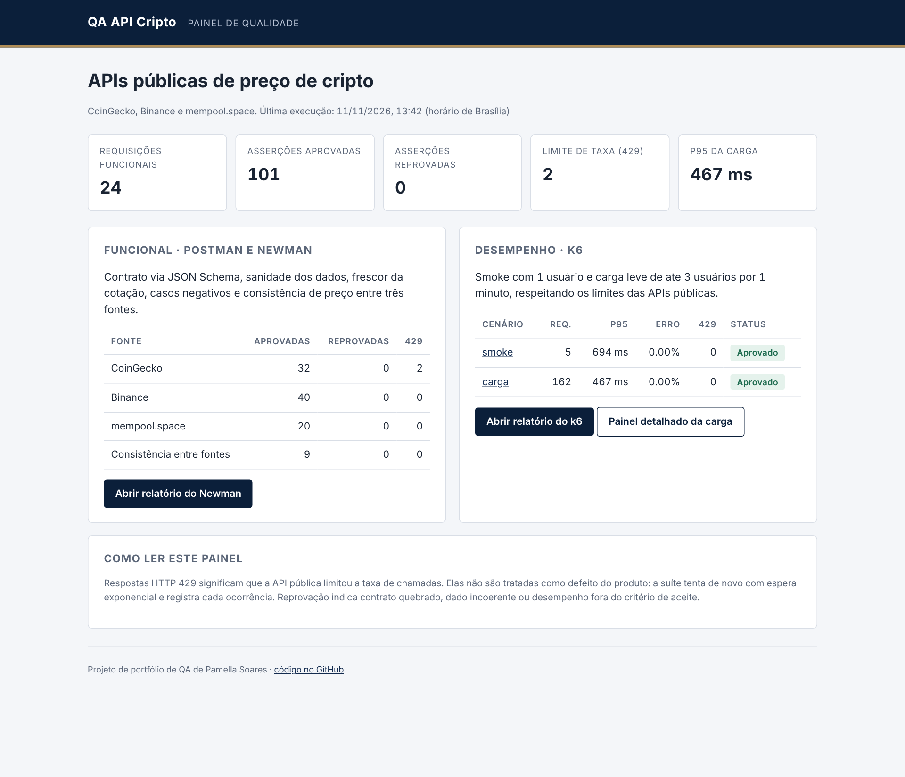
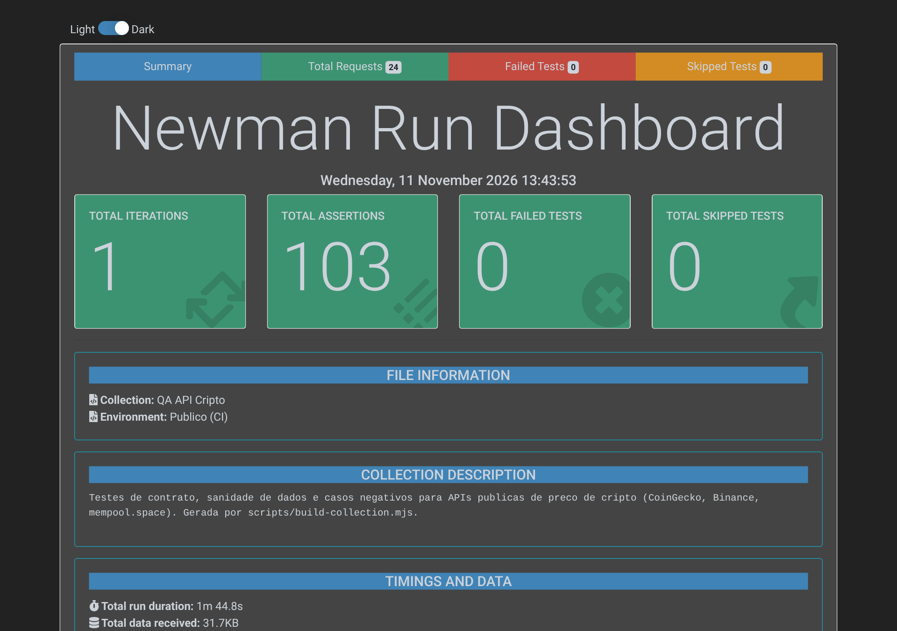
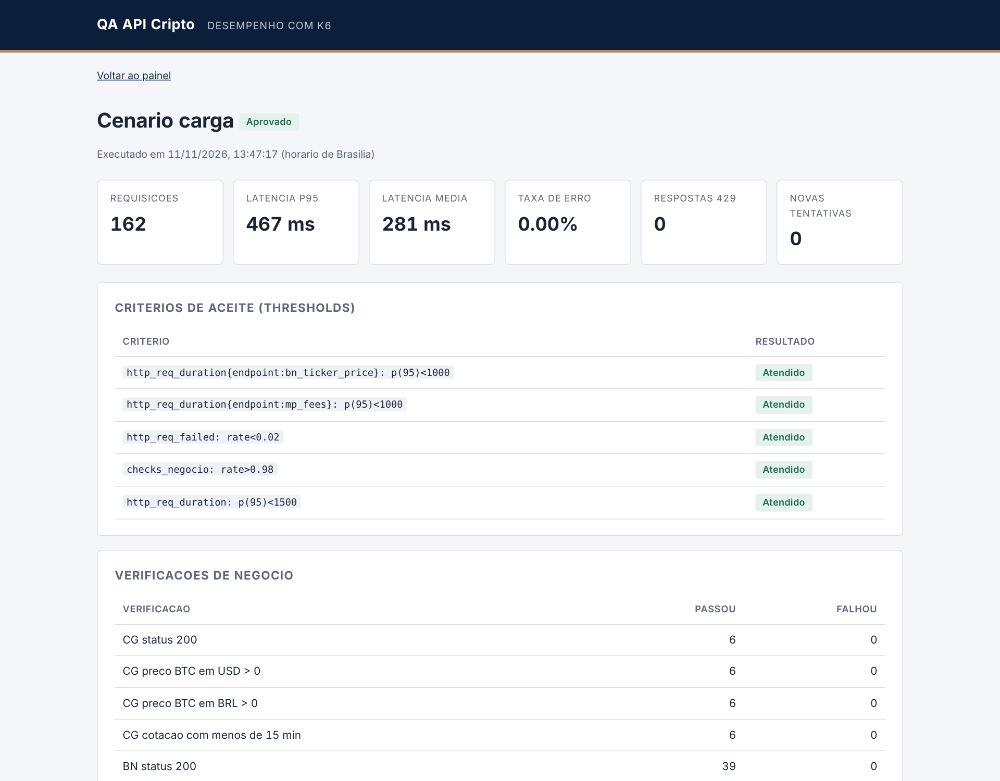

# QA API Cripto

[](https://github.com/pamteech/qa-api-cripto/actions/workflows/testes-api.yml)
[](https://pamteech.github.io/qa-api-cripto/)


Suíte de testes de API para três fontes públicas de dados de cripto: **CoinGecko**, **Binance** (dados de mercado) e **mempool.space** (rede Bitcoin). Cobre contrato, sanidade dos dados, casos negativos, consistência de preço entre fontes e desempenho sob carga leve. Roda todo dia no GitHub Actions e publica o relatório no GitHub Pages.

**Relatório ao vivo:** https://pamteech.github.io/qa-api-cripto/



## O que é testado

| Camada | Ferramenta | Quantidade |
|---|---|---|
| Funcional e contrato | Postman (coleção v2.1) executada pelo Newman | 22 requisições, cerca de 100 asserções |
| Desempenho | k6 | 2 cenários: smoke e carga leve |

**CoinGecko** (7 requisições): disponibilidade, preço simples de BTC e ETH em USD e BRL, dados de mercado, moedas de cotação suportadas e três casos negativos (moeda inexistente, moeda de cotação inválida e detalhe de moeda inexistente).

**Binance** (9 requisições): disponibilidade, relógio do servidor, preço BTCUSDT, estatísticas de 24h, livro de ofertas, candles de 1h e três casos negativos (par inexistente, intervalo inválido e parâmetro obrigatório ausente).

**mempool.space** (5 requisições): altura do último bloco, últimos blocos, taxas recomendadas, preço de referência e endereço inválido.

**Consistência entre fontes** (1 requisição): o preço do BTC em CoinGecko, Binance, Binance média de 5 min e mempool.space tem que concordar com desvio abaixo de 2%.

## Por que esses testes: riscos e oráculos

Uma API de preço errada não costuma cair, ela costuma responder **200 com um número errado**. Por isso a suíte vai além do status HTTP e usa oráculos de dados:

| Risco | Oráculo usado |
|---|---|
| Contrato muda e quebra quem consome | JSON Schema em todas as respostas de sucesso |
| Preço zerado, negativo ou trocado de moeda | Preço maior que zero, BTC maior que ETH, câmbio BRL/USD implícito igual para BTC e ETH |
| Cotação velha exibida como atual | `last_updated_at` e `time` com menos de 15 minutos |
| Dado de mercado incoerente | mínima ≤ último ≤ máxima, `priceChange = lastPrice - openPrice`, livro não cruzado e ordenado, candles OHLC válidos e consecutivos |
| Taxa de rede absurda | taxa rápida ≥ 30 min ≥ 1 h ≥ econômica ≥ mínima |
| Uma fonte diverge das outras | comparação cruzada entre três fontes independentes |
| Entrada inválida gera dado inventado | casos negativos com status e código de erro esperados |
| Lentidão ou travamento | no Newman, cada resposta abaixo de 5 s (guarda contra travamento, inclui DNS e TLS da primeira conexão); no k6, p95 abaixo de 1,5 s, que é o critério real de latência |

### Limite de taxa (HTTP 429)

As APIs são públicas e gratuitas, então o limite de chamadas faz parte do ambiente, não é defeito do produto. A suíte trata assim:

- **Newman:** um script de coleção detecta 429, respeita `Retry-After` quando existe e tenta de novo até 3 vezes com espera exponencial. Cada ocorrência vira uma linha `[LIMITE]` no relatório, e as asserções de negócio daquela resposta são puladas.
- **k6:** 429 fica fora de `http_req_failed`, é contado na métrica `limite_taxa_429` e gera nova tentativa com espera exponencial (`novas_tentativas`).
- A CoinGecko recebe no máximo 1 chamada a cada 10 s na carga, e o Newman espera 1,5 s entre requisições.

## Desempenho com k6

| Cenário | Perfil | Critérios de aceite |
|---|---|---|
| `smoke` | 1 usuário, 1 passada por fonte | 0% de erro, p95 < 2 s, 100% das verificações |
| `carga` | até 3 usuários por 1 min em Binance e mempool.space, CoinGecko a 1 chamada a cada 10 s | erro < 2%, p95 geral < 1,5 s, p95 < 1 s em preço Binance e taxas mempool, verificações > 98% |

A carga é propositalmente leve: o objetivo é medir latência e estabilidade sem abusar de um serviço público.

## Como rodar localmente

Requisitos: Node.js 20 ou superior e [k6](https://grafana.com/docs/k6/latest/set-up/install-k6/).

```bash
npm ci
npm run test:api      # Newman: relatório em reports/newman/index.html
npm run test:smoke    # k6 smoke
npm run test:carga    # k6 carga leve
npm run painel        # monta reports/index.html
```

Para importar no Postman: `postman/qa-api-cripto.postman_collection.json` com o ambiente `postman/publico.postman_environment.json`. A coleção é gerada a partir de `scripts/build-collection.mjs` (`npm run colecao`), o que facilita revisar a lógica dos testes em código.

O ambiente `binance-global` usa `api.binance.com`. Ele funciona fora dos EUA, mas responde HTTP 451 para IPs americanos, como os do GitHub Actions. Por isso a CI usa `data-api.binance.vision`, o endpoint público oficial só de dados de mercado.

## Integração contínua

O workflow [`testes-api.yml`](.github/workflows/testes-api.yml) roda em `ubuntu-24.04` a cada push, em pull requests e todo dia às 08:00 (horário de Brasília). Ele executa Newman, smoke e carga, monta o painel, publica no GitHub Pages e só então reprova o job se alguma etapa falhou. Assim o relatório fica disponível mesmo quando um teste quebra.

## Achados

- **CoinGecko responde 200 com objeto vazio para moeda inexistente** em `/simple/price`, em vez de 404. O mesmo vale para moeda de cotação inválida. A suíte documenta o comportamento e usa como oráculo "não inventar preço".
- **Preço atual da CoinGecko pode ficar acima da máxima de 24h** em `/coins/markets`, porque os campos são atualizados em momentos diferentes. A suíte aceita 1% de tolerância e registra o motivo.
- **`api.binance.com` bloqueia IPs dos EUA (HTTP 451).** Quem testa a partir de runners na nuvem precisa usar o endpoint de dados públicos.
- **Primeira chamada a frio pode passar de 4 s.** Numa execução da CI, o primeiro `GET /ping` da CoinGecko levou 4,8 s somando DNS, TCP e TLS em runner novo. O limite de 3 s reprovou o teste, e a análise mostrou que o oráculo media a conexão, não a API. O limite do Newman passou para 5 s como guarda contra travamento, e a latência passou a ser cobrada no k6, que separa tempo de espera e de conexão.
- **A CoinGecko pública devolve 429 depois de poucas chamadas seguidas.** Por isso a nova tentativa com espera exponencial e o registro separado.

## Estrutura

```
postman/   coleção v2.1 e ambientes
k6/        smoke, carga e utilitários (nova tentativa, métricas, relatório)
scripts/   gerador da coleção, painel HTML e capturas de tela
docs/      capturas usadas neste README
```

## Relatórios

| Relatório | Captura |
|---|---|
| [Newman (htmlextra)](https://pamteech.github.io/qa-api-cripto/newman/index.html) |  |
| [k6 carga](https://pamteech.github.io/qa-api-cripto/k6/carga.html) |  |

---

Projeto de portfólio de QA de Pamella Soares.
